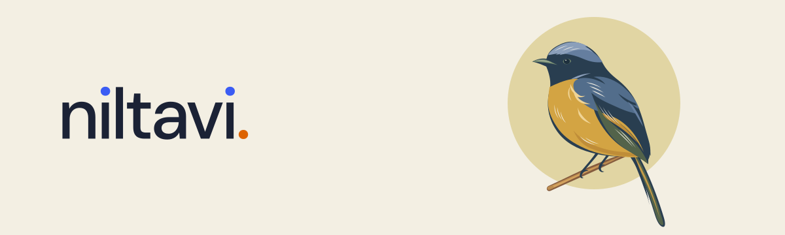

<a href="https://niltavi.com/">
  <picture>
    <source media="(prefers-color-scheme: dark)" srcset="https://raw.githubusercontent.com/niltavi/.github/main/profile/assets/niltavi-cover-dark.svg" />
    
  </picture>
</a>

<em>Naturalism in the Digital Age</em>

Niltavi takes its name and colors from the niltava, a bird of the forest. We make digital things with clear forms, quiet colors, and room to breathe, drawing from natural history illustrations and woodcut prints.

We welcome the possibilities of technology and cherish the small things that ask to be felt firsthand: sunlight through leaves, a passing breeze, a bird alighting on a branch.

- **[Niltavi UI](https://github.com/niltavi/niltavi-ui)** — A nature-inspired theme and component showcase for HeroUI. [Explore the UI →](https://ui.niltavi.com/)
- **[Niltavi Logo](https://github.com/niltavi/niltavi-logo)** — Wordmarks and bird illustrations in SVG and PNG.

[niltavi.com →](https://niltavi.com/)
